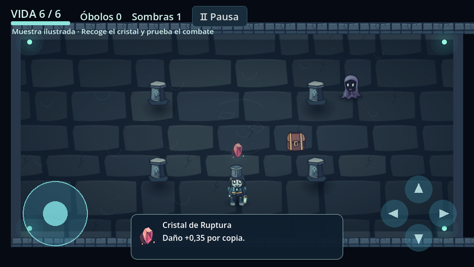
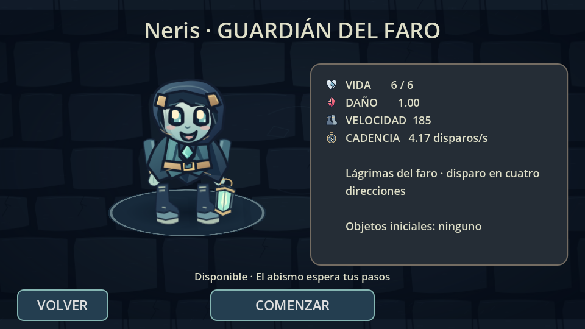

# Dirección artística · Muestra funcional 0.5.0

Entrega de la Etapa A, con la animación compartida de Neris como primer paso de
la Etapa B. Se conserva el proyecto 0.4.2 (`88dfef9`). El contenido pendiente
no se presenta como ya implementado.

## Dirección elegida

Ilustración 2D original en SVG con trazos Bézier, contornos de tinta, formas
caricaturescas y sombreado por capas. Sin pixel art, reescalado por vecino más
próximo, recursos descargados de otros juegos ni dependencias artísticas externas.
Los SVG se importan como texturas compartidas; no se rasterizan durante la partida.

| Función | Color |
| --- | --- |
| Tinta y separación de formas | `#131d2e` |
| Tela y piedra azul | `#344d68`, `#2b3a47` |
| Piel, farol y luz azul verdosa | `#91bdbb`, `#a7ecd2` |
| Sombras violetas | `#5b5c7d` |
| Cristal y acentos rojos | `#e4748b` |
| Brillos cálidos | `#fff2cd` |

Cabeza grande, ojos redondeados, cuerpo pequeño y extremidades legibles. Neris
conserva capucha, gema, cinturón, ropa, farol y estadísticas. La animación comparte
cuerpo, brazos, botas y farol entre el jugador, el menú, la selección y su reflejo.
Marcha, respiración, parpadeo, disparo, recogida, presentación, victoria y derrota
usan transformaciones de dibujo; daño conserva la reacción y la invulnerabilidad
existentes. No se añaden habilidades activas ficticias.

La Sombra Errante usa una nueva silueta de tela rota, pliegues, ojos y rostro
ilustrados. Conserva persecución, daño, animación de impacto y disolución de
muerte. Los otros diecinueve enemigos mantienen su arte y comportamiento actual;
el rediseño completo corresponde a la Etapa C.

Cristal de Ruptura, pedestal, cofre, puerta, columna y muro comparten contornos y
materiales. El cristal sigue aplicando su mejora de daño. Los proyectiles usan
una lágrima dibujada, conservando sus propiedades elementales y colisiones.
Sombras y brillos son texturas con degradados reutilizadas, sin luces dinámicas.

Tres superficies ilustradas de 1024×512 diferencian los pisos existentes con
piedra abandonada, musgo sombrío y marcas de ruinas violetas. No se añaden pisos
4 o 5 ni se renombran los biomas actuales. Las colisiones, columnas y posiciones
de puertas son las mismas. El detalle tiene menos contraste que los enemigos.

## Probar la muestra

Opciones → Modos y pruebas → Muestra ilustrada. Contiene Neris, una Sombra
Errante con IA real, cristal recogible, cofre con escudo y la habitación nueva.
Se puede recoger, abrir, combatir, recibir daño, ganar o perder usando los
controles habituales. El estilo también está integrado en las partidas normales,
el menú y la selección; no es solamente una imagen de presentación.

El panel de un objeto gratuito ahora es compacto para no tapar al protagonista.
Los botones COMPRAR y ABRIR COFRE mantienen su altura y su manejo de dedos
independientes. La compra, saldo, entrega y protección frente a duplicados no se
cambian por el rediseño.

## Recursos y rendimiento

Diecisiete SVG originales en `assets/illustrated`, sin archivos de relleno. La
textura mayor es de 1024×512. Neris utiliza una única textura de cuerpo 384×512
compartida, no varias copias de alta resolución por pantalla. Los recursos
ilustrados usan filtrado suave y mipmaps cuando se reducen. Bajo conserva el arte
y las colisiones; reduce brillos y efectos ambientales. Medio y Alto mantienen
los límites existentes de partículas, 16 enemigos y 96 proyectiles.

Medición comparativa con `tools/visual_resource_probe.gd`, misma escena inicial,
resolución 960×540 y texturas de las catorce reliquias cargadas. Godot 4.6.3,
Compatibility/Mesa llvmpipe en Linux; NO es una medición del ZTE:

| Monitor del motor | 0.4.2 | Muestra 0.5 |
| --- | ---: | ---: |
| Memoria estática informada | 34.696.008 B | 34.719.946 B |
| Memoria de texturas informada | 7.794.209 B | 18.544.761 B |
| Nodos | 65 | 65 |
| Llamadas de dibujo de la muestra observada | 86 | 84 |

Estos contadores no representan la memoria RAM total de Android ni prueban una
mejora de FPS. El aumento de texturas corresponde a superficies ilustradas y
personajes más nítidos; no aumenta el número de nodos por personaje.

Prueba sintética de física existente: cinco muestras de 720 pasos, 120 de
calentamiento, 16 enemigos y 96 proyectiles. Mediana 0.4.2: 0,285 ms/paso;
muestra 0.5: 0,257 ms/paso, con intervalos solapados. Excluye el renderizado y no
permite afirmar mejora de rendimiento ni 60 FPS en el teléfono.

APK anterior firmado: 28.012.591 bytes, ejecución 40410802465. El exportador ahora
registra automáticamente tamaño actual, diferencia en bytes y porcentaje frente
a esa referencia en los registros y resumen de GitHub Actions. No se fuerza un
APK de 80–200 MB si los recursos útiles ocupan menos.

## Verificación y límites

- Importación, integridad de recursos y arranque automatizados.
- Nueve suites: las ocho anteriores y `illustrated_art_tests.gd`, con 49
  comprobaciones de texturas, poses, estadísticas, IA, muestra, cristal, cofre,
  perfiles, colisiones, pisos y menú.
- La suite artística también se ejecuta con OpenGL. Se revisan capturas reales
  del motor; no son capturas del ZTE ni arte conceptual que sustituye al juego.
- Siguen ejecutándose las 52 comprobaciones de compras/recogida y las pruebas
  de escritura, lectura y archivo dañado de la configuración existente.

Pendiente: prueba física Android de claridad, memoria, tacto y rendimiento. La
barra lateral izquierda de selección, los diez personajes planificados, el resto
del arte de enemigos, jefes e iconos, audio y pulido global son etapas posteriores.
Actualmente solo existe Neris, tres pisos y catorce reliquias; la economía
progresiva y el guardado completo de partidas todavía no están implementados.
La configuración guardada y las compras persistentes durante una partida se
conservan. No se eliminan sistemas para facilitar el rediseño.

Licencia: gráficos SVG y animación nuevos originales del proyecto, MIT, igual
que el código. Licencias de Godot conservadas en Créditos dentro de Opciones.
