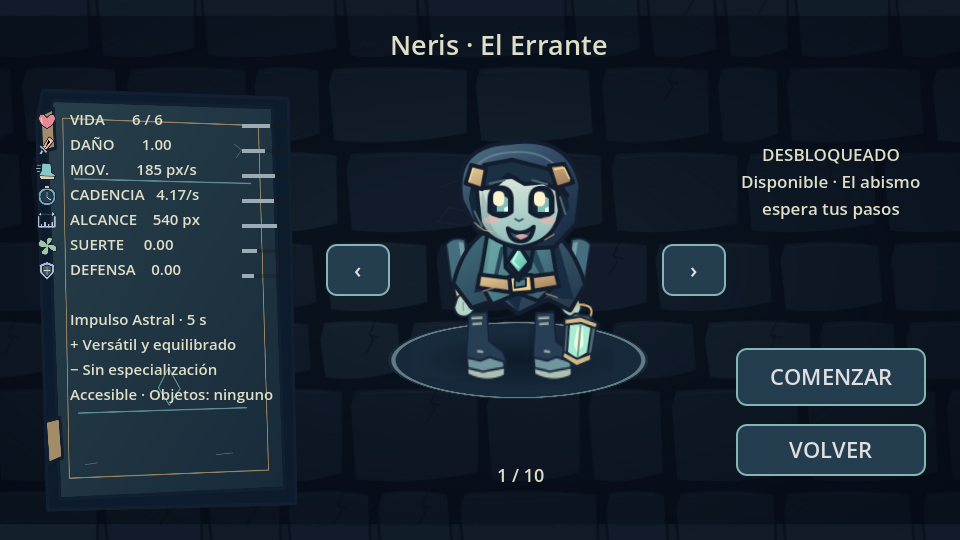
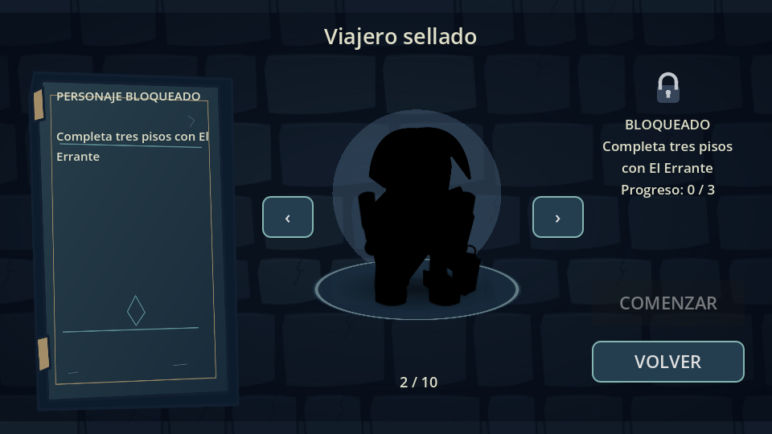
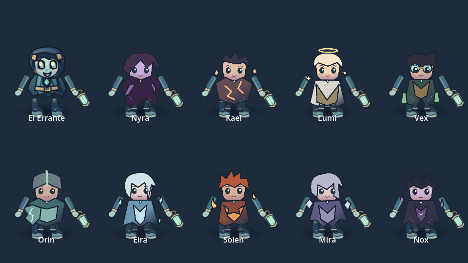

# Viajeros y recuerdos · 0.8.0 — entrega de prueba

No es la actualización final de 100 MB. La referencia 0.7.0 y su APK continúan disponibles; esta rama conserva todas sus mecánicas. Auditoría: [characters-audit-0.8.md](characters-audit-0.8.md).

## Personajes y selección

El ID `neris` se conserva como **Neris · El Errante**. La selección contiene las diez entradas desde el primer inicio, flechas con retorno circular, nombre oculto y silueta completamente negra para bloqueados, candado original, requisito/progreso numérico y bloqueo tanto en COMENZAR como en el coordinador del juego.

Los valores se crean con `CharacterCatalog.preview_stats`; el jugador recibe `initial_stats` del mismo catálogo. No se inicia una partida durante una vista previa. Las barras comparan atributos con El Errante y los números indican valores de combate reales.

| Personaje | Vida | Daño | Movimiento px/s | Disparos/s | Alcance px | Defensa | Habilidad · recarga |
|---|---:|---:|---:|---:|---:|---:|---|
| Neris · El Errante | 6 | 1.00 | 185 | 4.17 | 540 | 0.00 | Impulso Astral · 5 s |
| Nyra | 4 | 0.85 | 225 | 4.17 | 540 | 0.00 | Paso Umbrío · 9 s |
| Kael | 6 | 1.45 | 160 | 3.23 | 540 | 0.00 | Ruptura · 8 s |
| Lumi | 8 | 0.80 | 185 | 3.57 | 540 | 0.25 | Luz Restauradora · 24 s |
| Vex | 6 | 0.80 | 185 | 4.17 | 540 | 0.00 | Mezcla Inestable · 10 s |
| Orin | 6 | 1.00 | 155 | 4.17 | 440 | 0.50 | Barrera Antigua · 12 s |
| Eira | 6 | 1.00 | 185 | 3.45 | 640 | 0.00 | Prisión de Escarcha · 10 s |
| Solen | 6 | 1.00 | 185 | 4.17 | 480 | -0.20 | Explosión Solar · 11 s |
| Mira | 4 | 0.80 | 185 | 4.17 | 540 | 0.00 | Reflejo Viviente · 12 s |
| Nox | 3 | 1.25 | 210 | 4.17 | 540 | -0.10 | Poder del Abismo · 16 s |

Suerte inicial: Vex 0.5 y los demás 0. El campo ya existía; aún no altera las tablas de botín. No se muestran críticos inventados.

- Errante: desplazamiento de 0.22 s a 520 px/s, colisiones conservadas e inmunidad breve.
- Nyra: señuelo de 3 s; la IA persigue/dispara hacia él, pero el contacto sigue comprobando la posición del jugador real.
- Kael: proyectil de daño triple y cuatro perforaciones; hereda elementos y rebote de las reliquias.
- Lumi: zona de radio 72 durante 4 s, recuperación total máxima de 1.5 y solo dentro de la zona.
- Vex: alterna fuego, hielo y electricidad durante 4 s. Los elementos siguen el sistema real de impactos existente.
- Orin: barrera de 3 s que no consume innecesariamente el escudo periódico del inventario.
- Eira: ralentización de 3 s en radio 145.
- Solen: quemadura en ataques normales y explosión de daño/quemadura en radio 145.
- Mira: copia visual de 4 s y proyectiles reales adicionales; comparte el límite global de 96. Una copia no crea otra copia.
- Nox: +0.45 daño y -0.05 s de intervalo durante 4 s; después -0.15 daño y -40 px/s durante 2 s. La curación de tónicos/fuentes se reduce a 1. Los modificadores temporales tienen fuente propia y no borran mejoras permanentes.

El botón Habilidad tiene icono propio y recarga numérica, usa un dedo independiente y se sitúa por encima de los controles de ataque. Espacio también activa la habilidad en pruebas de escritorio. La pausa congela temporizadores; cambiar de sala no reinicia las recargas ni los efectos.

## Progreso persistente

`Progress` registra enemigos, jefes, minijefes, pisos, pisos con El Errante, racha sin daño, objetos únicos, secretos y finales. Los adaptadores de juego solo registran partidas de mazmorra; las demostraciones, el laboratorio y la selección no conceden logros. Invocados débiles no cuentan como enemigos derrotados.

Se consumen tokens de evento antes de actualizar contadores. Piso completado usa un token por piso; los enemigos también están protegidos por la pertenencia a la lista y su estado de muerte. Comenzar una partida limpia los tokens de esa partida, no los logros permanentes.

`user://progress.json` tiene versión 1, validación, límites, escritura temporal, copia `.bak` y recuperación ante corrupción. Un error de escritura revierte el evento y avisa. `user://settings.json` conserva su formato y contenido; no existía un guardado completo de partida en 0.7.0 y no se inventa CONTINUAR.

**Opciones → Progreso** permite copiar un código AOT1 a las notas del teléfono y restaurarlo posteriormente. La restauración combina máximos y descubrimientos sin borrar logros posteriores. No incluye una partida en curso ni ajustes. El código no está cifrado ni es una protección contra modificaciones manuales del usuario.

**Pendiente de contenido, declarado en la selección:** Vex necesita veinte objetos diferentes, pero el catálogo actual tiene catorce. Orin necesita un minijefe y todavía no existe ese tipo de encuentro. Sus estadísticas, sprites y habilidades están implementados y probados con desbloqueos de prueba aislados; esos desbloqueos artificiales no existen en el código de publicación. Los otros ocho pueden desbloquearse mediante el contenido actual. No se sustituyen requisitos silenciosamente.

## Arte, sonido y animaciones

Se conserva el Neris ilustrado y se añaden nueve ilustraciones SVG originales de 384 × 512, con trajes, peinados, accesorios y siluetas diferentes: capa de Nyra, fracturas de Kael, aureola de Lumi, gafas/frascos de Vex, armadura/escudo de Orin, escarcha de Eira, llama de Solen, espejos de Mira y corona/capa irregular de Nox. Diez iconos de habilidad originales. Reutilizar brazos, botas y farol conserva la identidad del mundo y reduce recursos.

Las piezas comparten animación por transformaciones; hay variaciones de ritmo por personaje. Reposo, caminar, disparo, daño, habilidad, recogida, victoria, derrota, aparición de habitación y presentación de selección tienen respuestas visuales. No se trata de diez animaciones esqueléticas completas ni de un paquete de retratos pintados de alta resolución: esa calidad artística final sigue pendiente.

Sonidos originales de habilidades y desbloqueo: síntesis mono 22.05 kHz generada al necesitarla, sin samples externos. Son motivos breves provisionales, no música de producción.

Licencia: código y SVG nuevos bajo MIT del proyecto; no se han usado sprites, tipografías, sonidos ni interfaces de Isaac. Las capturas de referencia solo orientan la funcionalidad.

La última imagen es una galería de revisión interna con todos los trajes revelados; la selección real mantiene los bloqueos.

## Validación y APK

- Referencia: doce suites e importación ejecutadas sin errores antes de modificarla.
- Actualización: trece suites completas, importación, escena principal y rutas. Suite nueva de personajes/progreso: 253 comprobaciones, incluyendo persistencia, corrupción, copia portátil, deduplicación, errores de escritura, diez habilidades, modificadores durante Nox, cambio de sala, pausa y tres dedos simultáneos.
- Las pruebas antiguas que exigían un único personaje se actualizan por la expansión solicitada; las de economía, compras/cofres, pisos y combate se conservan.
- Capturas reales de Godot Compatibility sobre Mesa llvmpipe. No son capturas del ZTE 8050.
- Exportación local ARM64 firmada: **29,282,405 bytes (29.28 MB; 27.93 MiB)**. Referencia 0.7.0 de CI: 28,929,791 bytes. Tamaño definitivo de CI y enlace se registran después de la ejecución, pues pueden diferir algunos bytes.
- El exportador verifica firma, ZIP, manifest, ABI, compatibilidad Android 13, modo sin Internet y JSON de economía. `apk-size.json` acompaña al APK en el artefacto y declara si se cumplen 100,000,000 bytes.
- El workflow permite marcar **require_100_mb** para exigir ese mínimo. Está desactivado para estos APK de prueba y falla antes de publicar si se exige y no se cumple.

**No se cumple el mínimo de 100 MB.** Faltan recursos de producción útiles: retratos ilustrados con más detalle, animaciones/artes de mayor elaboración, música original por piso/jefes y bancos de sonidos terminados. No se han añadido archivos aleatorios, duplicados ni texturas innecesariamente grandes. Esta actualización final permanece incompleta aunque el APK de prueba compile.

La firma de depuración existente sigue siendo efímera por ejecución. El conector permite publicar código, pero consultar/configurar secretos devuelve HTTP 403; no se ha fingido una clave persistente. Android puede rechazar instalar encima de una compilación firmada con otra clave. No desinstales una versión con progreso sin copiar antes su código de respaldo cuando esa versión disponga de la función. Una firma estable necesita una configuración de secretos que este acceso no permite.

## Pruebas pendientes en Android

1. Instalar/abrir el APK desde el artefacto de Actions, con sesión iniciada en GitHub.
2. Nueva partida: recorrer las diez entradas; comprobar siluetas, requisito, progreso y rechazo de COMENZAR bloqueado.
3. Probar movimiento, ataque y Habilidad simultáneos; pausa, pérdida de foco, distintas escalas y perfiles gráficos.
4. Desbloquear un personaje jugando, salir y abrir de nuevo; comprobar conservación y animación de revelación.
5. Copiar el código de progreso a Notas y probar restauración conservando logros más recientes.
6. Comprar, abrir cofres y recoger objetos con personajes desbloqueados. Comprobar efectos y recargas después de cambiar de sala.
7. Medir FPS, memoria y calentamiento del ZTE 8050 en situaciones comparables. No se afirma 60 FPS ni mejora medida en ese dispositivo.
