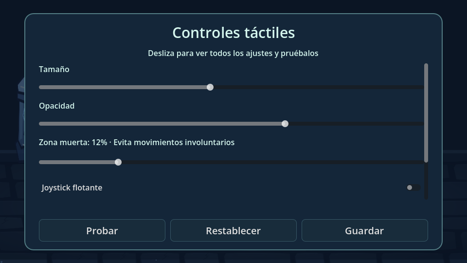
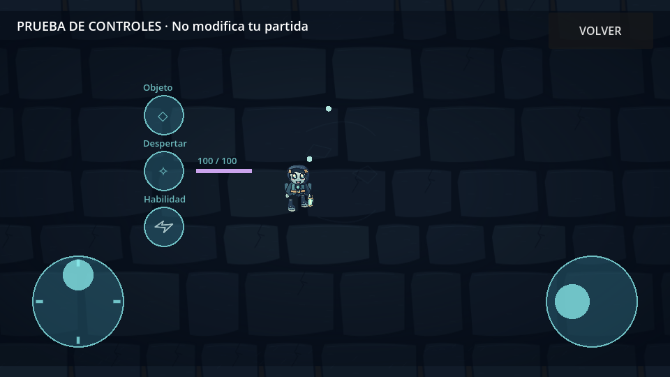

# Controles y publicación pública 0.9.1

Referencia: `reference/0.9.0-before-public-controls`, commit `6b6c065`. El cambio se prepara aislado en `controls/0.9.1-public-preview` y conserva los sistemas de juego.

## Causas corregidas

El controlador anterior permitía que un arrastre de un dedo no capturado entrara en disparo. También reasignaba prioridad al borrar/reinsertar direcciones durante el arrastre y dependía del coordinador para limpiar la entrada al perder foco. Los controles solo tenían posiciones fijas y no calculaban las zonas seguras de Android.

Ahora cada dedo adquiere un único rol al pulsar. Ese rol se conserva hasta levantarlo, incluso al salir del botón. El último dedo de disparo conserva prioridad hasta soltarse. La cruceta se puede arrastrar sin huecos, con histéresis para evitar saltos en diagonales. Se mantienen ocho direcciones de movimiento y cuatro de disparo.

El joystick flotante usa el punto real de pulsación como origen de entrada y una base visual limitada a la zona segura; pulsar cerca de un borde no provoca movimiento inicial. La zona muerta se reescala para conservar la velocidad máxima. El modo zurdo también cambia la posición del panel de estadísticas para evitar los botones de acción.

Los productos y otros botones de interfaz pueden excluir sus rectángulos de la captura de juego. La simulación de práctica tiene su propio controlador, proyectiles acotados y personaje decorativo; no actualiza estadísticas, inventario, logros ni monedas de la partida pausada.

Los nuevos ajustes se añaden al formato 1 existente, con validación y valores predeterminados. El menú dedicado tiene desplazamiento y botones grandes. La recarga visual se sincroniza antes de habilitar la entrada de una nueva partida, sin conservar un estado viejo durante su primer fotograma.

## Publicación

La instrucción del usuario autoriza una descarga pública. Se publica una **prueba pública** en GitHub Releases; no se presenta como una versión definitiva con arte o rendimiento verificados en el teléfono.

El workflow compila etiquetas `v*-public`. Su trabajo de compilación conserva permisos de lectura y valida/exporta el APK. Un trabajo separado de publicación tiene `contents: write` únicamente para esas etiquetas. Descarga el artefacto de esa misma ejecución y ejecuta `tools/publish_release.py`.

El publicador comprueba versión de etiqueta, tamaño, ZIP, ABI, manifest y los dos JSON de recursos frente al código. Crea primero un borrador, sube APK, informe de tamaño y SHA-256, descarga el APK subido y compara su hash antes de hacer público el borrador. Nunca sustituye silenciosamente un APK ya publicado. El recurso de Releases no caduca a los catorce días como el artefacto temporal de Actions, y su descarga pública no necesita iniciar sesión.

`actions/download-artifact` está fijado al commit `634f93cb2916e3fdff6788551b99b062d0335ce0`, verificado desde la referencia v5 de la acción.

La firma actual continúa siendo de depuración efímera. No se publican claves privadas; antes de reinstalar es necesario conservar el código de progreso. Configurar una firma estable para futuras actualizaciones sigue pendiente de un acceso a secretos que la integración no tenía en las entregas anteriores.

## Validación

- Referencia 0.9.0: quince suites e importación ejecutadas antes de modificarla.
- Nueva suite de controles: 231 comprobaciones de captura, prioridades, arrastres, cinco acciones, perfiles, zonas seguras, persistencia y aislamiento de la práctica.
- Publicador: nueve pruebas de integridad, etiqueta/versión, borrador e inmutabilidad.
- Se conservan todas las suites de personajes, Shader, objetos, economía, cofres, compras y mazmorras.
- Los enlaces definitivos y el tamaño exacto se registran en el PR y la publicación después de terminar Actions.

Pendiente: probar tacto, comodidad y rendimiento en el ZTE 8050 y otros Android. Las pruebas de entrada sintética y el renderizador de escritorio no equivalen al teléfono.

Capturas reales de Godot Compatibility/Mesa; no son capturas del ZTE 8050.
