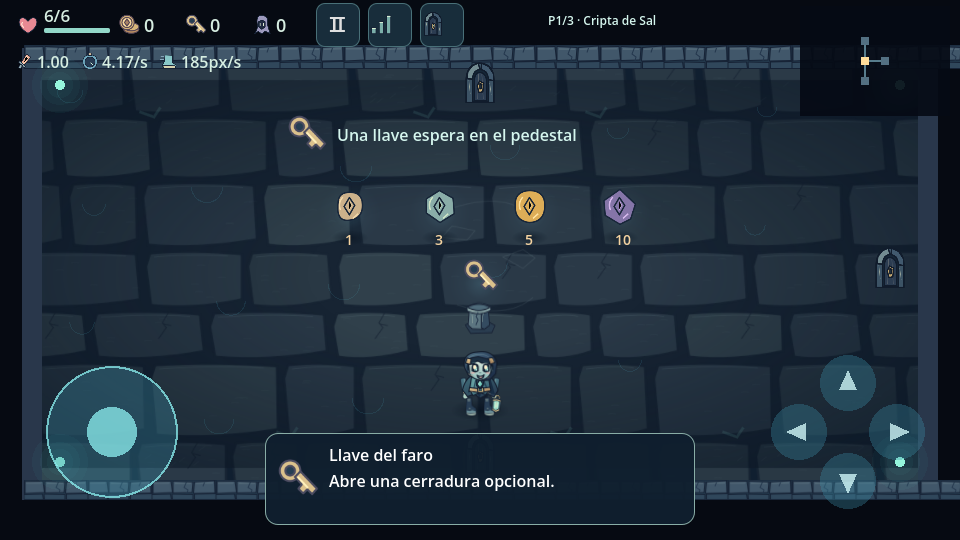
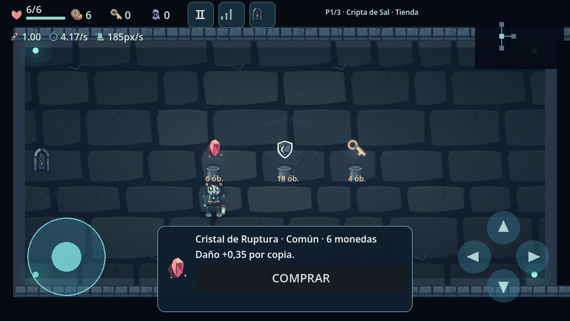
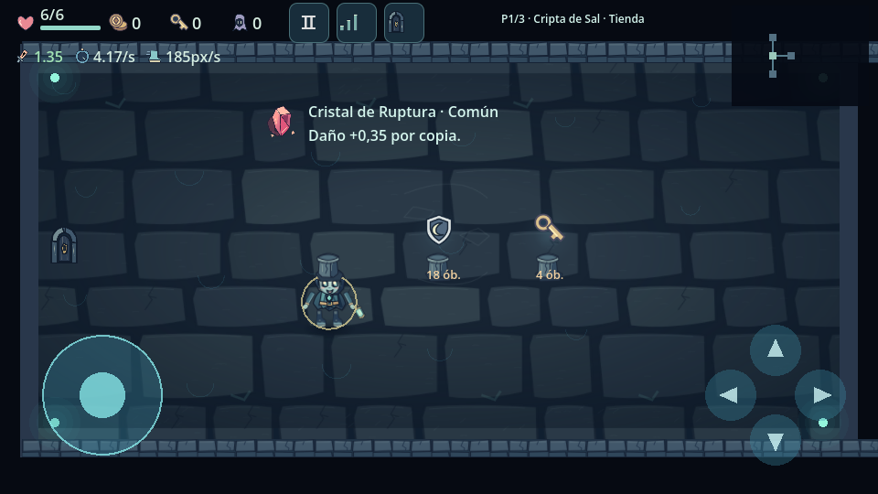

# Auditoría y corrección económica · 0.7.0

Primero se inspeccionó 0.6.0 y se ejecutaron sus once suites sin fallos.
[Auditoría previa por sistema](audit-0.7.md). La actualización usa la rama
`balance/0.7-economy-and-loot`, conservando `68a7a91` como referencia estable.
No reinicia el proyecto ni presenta todo el plan maestro como completado.

## Causas reales y correcciones

La base pagaba cada enemigo inmediatamente, además de 2–5+piso por sala, cinco
monedas por premio de barril/cofre y tres por reliquia al máximo. También podía
repetirse el callback de muerte sin una guarda propia y las criaturas invocadas
eran una fuente renovable. No hacía falta un error de guardado para explicar el
saldo elevado: todavía no existe guardado completo de partida.

Ahora:

- Enemigo normal: 3 % de soltar moneda física. Blindado/coloso: 5 %. Las
  criaturas invocadas débiles no dan dinero. El 15 % de la API de élites está
  preparado y probado, pero no se anuncian élites jugables nuevos.
- La pertenencia a la lista de enemigos se consume antes de entregar premios:
  el mismo callback no puede entregar una moneda dos veces.
- Al limpiar combate/salida: 65 % de moneda, principalmente de valor 1.
  El jefe tiene presupuesto controlado: 5, 6 y 8 monedas en los tres pisos
  existentes, dividido en denominaciones reales; no hay paga ordinaria añadida.
- Barriles: 65 % vacíos, 20 % moneda, 15 % llave. Su activación se registra
  una sola vez. Los cofres y las salas conservan entrega única.
- Reliquia gratuita al máximo: compensación de una moneda, no tres. El producto
  de tienda al máximo no se compra ni cobra: muestra LÍMITE ALCANZADO.
  Al crear stock se evitan las reliquias que ya están al máximo.

El HUD muestra el saldo real. No se resta dinero del contador para aparentar
dificultad y no se introducen saldos negativos. Monedas de valor 1, 3, 5 y 10
utilizan iconos, nombres, cantidades y efectos reales. Las proporciones de
valor de una moneda de enemigo son 94 : 5 : 0,9 : 0,1; el valor 10 es excepcional.
Los presupuestos de jefe se dividen en monedas de 5, 3 y 1, sin garantizar
un óbolo oscuro al llegar a diez. Los premios antiguos sin `amount` conservan su valor anterior de cinco; todas
las fuentes nuevas generan una denominación explícita.

## Datos ajustables y utilizados

`data/balance.json` contiene tablas independientes, validadas y leídas por el
juego offline: oportunidades por enemigo, denominaciones, monedas por sala,
presupuesto de jefe, barriles, contenido de cofre, aparición ordinaria de
objetos, precios por piso/rareza, factores de utilidad y rarezas por contexto.
El exportador verifica que el APK incluya exactamente el mismo JSON validado.
No hay un porcentaje global que controle todos los sistemas.

La oportunidad ordinaria de objeto es 16 %; tesoro y jefe conservan un objeto
asegurado. Las oportunidades de rareza base son las pedidas:

| Piso | Común | Poco común | Raro | Épico | Legendario |
| --- | ---: | ---: | ---: | ---: | ---: |
| 1 | 75 | 22 | 3 | 0 | 0 |
| 2 | 65 | 27 | 7 | 1 | 0 |
| 3 | 55 | 31 | 12 | 2 | 0 |
| 4 | 46 | 33 | 17 | 3,5 | 0,5 |
| 5 | 38 | 34 | 21 | 6 | 1 |
| 6+ | 32 | 34 | 24 | 8 | 2 |

Se elige primero la rareza y después un objeto de esa rareza. El número de
objetos de un grupo no falsea su probabilidad. Tienda, cofre, tesoro, secreto y
jefe tienen tablas distintas: el secreto ya no garantiza épico/legendario.
El jefe ofrece calidad superior sin garantizar legendario. Stock sin duplicados
y sin reliquias al máximo condiciona la selección; no equivale a dos sorteos
independientes con reemplazo. Las tablas de pisos 4+ se preparan y prueban como
datos, pero solo hay tres pisos jugables.

Precios comunes/raros/épicos: 6–9 / 15–20 / 28–36 en el primero; 8–12 / 20–27 /
36–46 en el segundo; 11–16 / 27–35 / 45–58 en el tercero. Hay filas preparadas
para 4 y 5, y una escalada posterior limitada; precio máximo 160. Los factores
de utilidad de corazón/corona/espejo están separados de los rangos de base.
Las llaves siguen costando cuatro. No hay aún tiendas raras nuevas.

## Recogida, compra y cofre

Se conserva la entrega confirmada de `RelicPickup` y su contrato común. La ficha
local añade rareza real junto a icono, nombre, descripción y COMPRAR. Sin dinero
muestra MONEDAS INSUFICIENTES. Saldo reservado, reversión si la entrega falla,
protección frente a pulsaciones rápidas y compras reentrantes siguen probadas.

Los cofres exponen estados cerrado, disponible, abriéndose, abierto y entregado,
derivados de sus datos persistentes durante la partida. No permiten reclamar
prematuramente durante la animación ni entregar repetidamente su contenido.
No se añaden todavía las ocho familias de cofre.

## Simulaciones ejecutadas

[Informe JSON íntegro](economy-simulation-0.7.json). Se simularon 2.000 recorridos
por estrategia, con los tres pisos, tablas y generadores de producción, llaves
para secretos/cofres y dos políticas de gasto. Se presupone completar los
combates, recoger premios accesibles y volver a la tienda al final; no simula
daño, muertes, compra de llaves ni gasto en curación. No es telemetría de Android
ni mide la probabilidad de que una persona complete la partida.

Política de comprar lo asequible empezando por lo barato:

| Piso | Ingreso medio del piso | Saldo medio antes de tienda | Compras medias | Puede pagar ambas reliquias |
| --- | ---: | ---: | ---: | ---: |
| 1 | 13,14 | 13,14 | 1,13 | 16,2 % |
| 2 | 15,37 | 20,12 | 1,12 | 17,2 % |
| 3 | 18,67 | 26,69 | 0,87 | 5,4 % |

El ingreso acumulado medio al terminar el segundo piso es aproximadamente
28,51, antes de restar compras, lejos del ejemplo anterior de 163. Con la
política de ahorrar para raro, el saldo medio antes de tienda en el segundo
es 28,00 y en el tercero 42,35: ahorrar sí permite acceder a ofertas que la
política de gasto frecuente no puede pagar. No garantiza que siempre aparezca
una oferta rara ni que todos los recorridos tengan esas cifras.

En los 2.000 recorridos observados hubo cero premios legendarios en los pisos
1 y 2; 25 en el tercero, exclusivamente posibles por sus tablas especiales,
sobre 9.548 premios de reliquia registrados. No se garantizan legendarios.

## Pruebas y preservación

Doce suites automatizadas aprobadas, incluyendo 468 comprobaciones nuevas de
configuración, tasas empíricas, denominaciones, tablas por piso, precios,
mutaciones de datos que afectan al juego, compra y recogida reales, guardas de
muerte/barril, cofre y simulación de 1.000 recorridos como prueba de balance.
La suite económica también pasó con Compatibility/OpenGL Mesa. Las capturas
son del motor con condiciones de prueba; no son capturas del teléfono.

Las pruebas antiguas se adaptaron solo donde cambian reglas deliberadas: ya no
se exige pago automático por muerte ni legendario base en el primer piso; la
prueba de barril fuerza su rama con premio y se prueba aparte la protección.
Se conservan pruebas de dinero, transacción, física, alcance de objetos, compras
baratas/caras/sin fondos, menú, selección, HUD, enemigos, cofres y tres pisos.

La auditoría detectó las limitaciones pendientes y no las borra: 14 reliquias,
Neris, 20 enemigos normales, un jefe, tres pisos y doce interiores. Faltan 40
objetos, diez personajes/activas/desbloqueos, nuevas categorías de salas,
variantes de jefes/cofres, audio y guardado completo. La configuración existente
se sigue guardando y validando; no se afirma que las compras sobrevivan a cerrar
la aplicación. Prueba física ZTE/FPS pendiente.

## Probar en el ZTE

Descargar el APK de GitHub Actions, extraer el ZIP e instalarlo. Iniciar una
mazmorra, derrotar enemigos y comprobar que ya no se abona cada muerte. Recoger
una moneda física y comprobar su valor. Visitar la tienda, revisar precio y
rareza, intentar comprar sin fondos y después con fondos. Abrir un cofre y
volver a una sala: el premio vendido/recogido no debe reaparecer.
