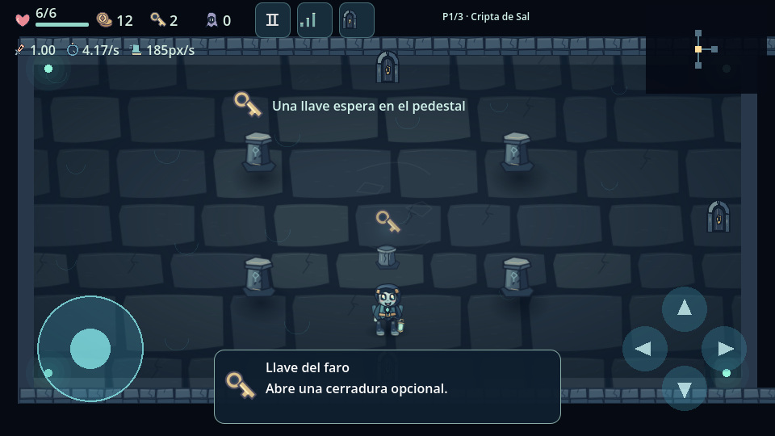
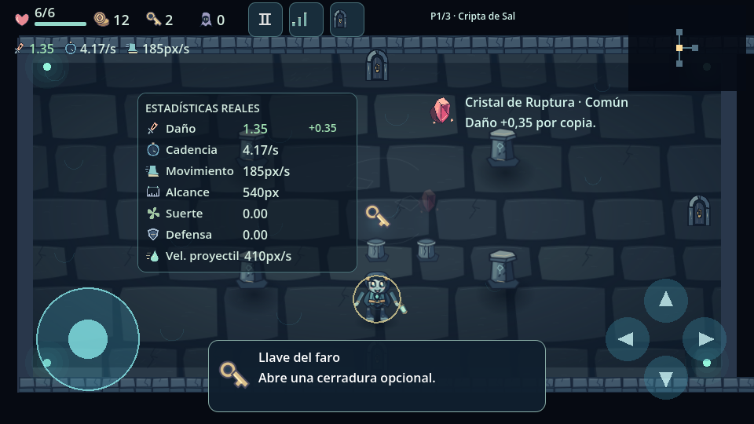

# Entrega A · HUD y estadísticas · 0.5.1

Actualización incremental sobre 0.5.0 (`6e27776`). Rama
`ui/0.5.1-compact-hud`. Las habitaciones, economía y rarezas pertenecen a las
siguientes entregas; esta entrega no altera sus reglas ni disimula cantidades.

## HUD compacto

La esquina superior izquierda muestra iconos originales de vida, óbolos, llaves
y enemigos activos, acompañados por números. El corazón conserva una barra
compacta y valores exactos: por ejemplo, un daño de 0,25 cambia `6/6` a
`5.75/6`, sin redondear hacia arriba. La cifra de enemigos cuenta enemigos reales;
no se presenta como una moneda o un recurso nuevo. La incursión conserva además
su indicador de oleada.

Pausa, estadísticas y puertas son botones de al menos 44×44. El icono de puerta
abre la misma navegación existente. El minimapa sigue arriba a la derecha.
El piso aparece en texto discreto, limitado en ancho. No se borran puertas,
llaves ni funciones de exploración para hacer sitio.

## Estadísticas reales

El botón con barras recorre tres estados: principales → ampliadas → ocultas.
La preferencia se guarda al cambiarla, en `user://settings.json`. La vista
inicial muestra daño, cadencia y movimiento. La vista ampliada añade alcance,
suerte, defensa y velocidad del proyectil.

| Dato | Fuente utilizada | Unidad |
| --- | --- | --- |
| Daño | `ActorStats.damage` | daño por impacto |
| Cadencia | `1 / ActorStats.attack_interval` | disparos/s |
| Movimiento | `ActorStats.speed` | píxeles lógicos/s |
| Alcance | `ActorStats.attack_range` | píxeles lógicos |
| Suerte | `ActorStats.luck` | valor del atributo |
| Defensa | `ActorStats.defense` | reducción plana aplicada por combate |
| Vel. de proyectil | `ActorStats.projectile_speed` | píxeles lógicos/s |

Neris empieza con daño 1,00, 4,17 disparos/s, movimiento 185 px/s y alcance
540 px. El cristal cambia inmediatamente el daño a 1,35 y muestra `+0.35` en
verde. Las reducciones temporales se muestran en rojo; al desaparecer se reflejan
los valores restaurados. Los indicadores duran como máximo 2,8 s y se limpian
al empezar otra partida. No se mantienen copias de estadísticas de combate.

La suerte muestra el campo real (actualmente 0); el generador todavía no lo usa
como modificador de recompensas. No se inventan probabilidad crítica ni recarga
de una habilidad activa que todavía no existen.

El panel ampliado es opcional, transparente y no captura movimiento ni disparos.
Su posición se ajusta al centrado de la habitación para dejar visibles las cuatro
puertas físicas y los controles. Los avisos de recogida se recolocan a su derecha
cuando está abierto. Durante la pausa se oculta el panel y vuelve al reanudar.

## Guardado y compatibilidad

La opción nueva es `stats_view`: 0, 1 o 2. El formato existente sigue en versión
1; archivos anteriores reciben 0 sin perder calidad gráfica, escala, opacidad o
diagnóstico. Se aceptan los números flotantes que produce el parser JSON y se
validan tipos/rangos. Si escribir falla, se restaura la vista anterior y se
muestra un aviso. La configuración antigua y la recuperación de archivos dañados
se conservan.

El guardado completo de una partida todavía no existe. Por tanto, esta entrega
no afirma guardar monedas, habitaciones o compras al cerrar la aplicación.
Los diccionarios de la partida mantienen los mismos datos durante su ejecución.

## Pruebas

Validación previa de 0.5.0 aprobada. Después: importación, rutas, arranque y diez
suites sin fallos, incluyendo 71 comprobaciones nuevas en `tests/hud_tests.gd`:

- Vida fraccionaria, daño y curación reales.
- Saldo 163 mostrado como 163: no se reduce el contador visualmente.
- Llaves al recoger y gastar; dinero tras compra; enemigos tras muerte.
- Estadísticas reales, mejoras y penalizaciones, colores y expiración.
- Tres vistas, escritura/lectura real, migración y fallo de escritura.
- Dedo independiente en estadísticas mientras se mantiene el joystick.
- Botones, puertas, minimapa y controles a 960×540, 1280×540 y 960×600.
- Pausa/reanudación, menú y oleadas conservados.

La suite también se ejecuta con Compatibility/OpenGL Mesa. Las capturas son
reales del motor; no son capturas ni mediciones de rendimiento del ZTE 8050.
Las otras suites siguen comprobando compras, cofres, recogida, IA, generación,
combate, gráficos, opciones y controles. No se añade una búsqueda de nodos por
fotograma; el HUD conserva referencias y solo modifica textos cuando cambian.

## Comprobación en Android

Instalar el APK de Actions, iniciar partida y comprobar el corazón y contadores.
Pulsar el icono de barras para ampliar, ocultar y volver a mostrar estadísticas.
Recoger un cristal, sufrir daño y curarse. Comprar, gastar una llave, pausar y
reanudar. Cerrar y volver a abrir la aplicación: la vista elegida debe conservarse.
Comprobar también movimiento y disparo simultáneos en el teléfono.

Pendiente de esa prueba física: tacto, zonas seguras y FPS en ZTE. No se afirma
haber alcanzado 60 FPS.

## Siguientes entregas

B: estructuras y distribuciones interiores. C: categorías y generación de
habitaciones. D: economía. E: rarezas y recompensas. F: puertas y eventos.
G: equilibrio y optimización.

La investigación de economía confirma que `on_enemy_defeated` suma directamente
la recompensa de cada enemigo; además hay monedas al limpiar habitaciones,
cofres y compensación por reliquias al máximo. Esto puede explicar la acumulación
rápida reportada. Esa mecánica sigue intacta en A: debe corregirse en D con
probabilidades configurables y simulación, no cambiando el número que muestra
el HUD. Tampoco se presentan como implementadas las 36 variantes de habitación.
