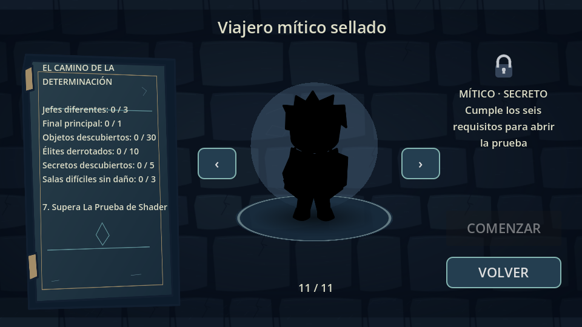
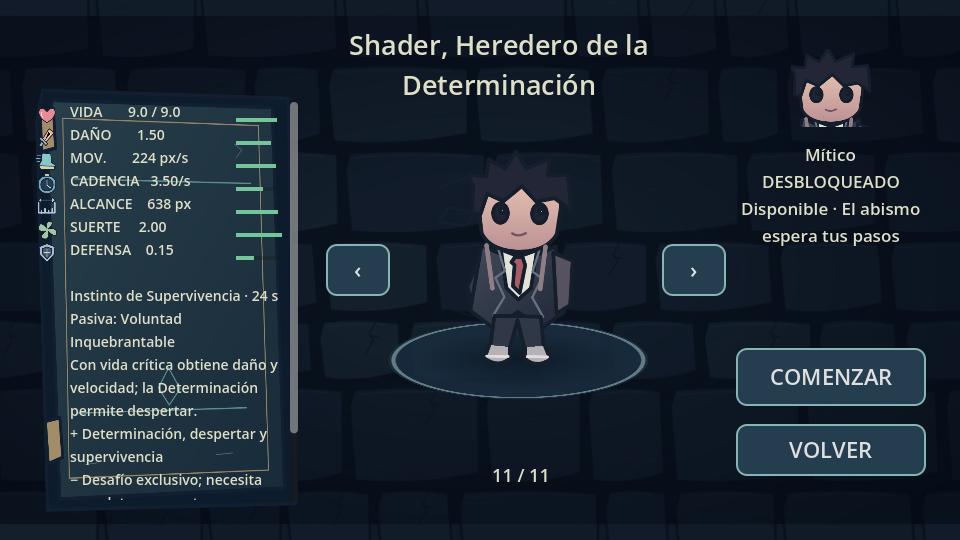
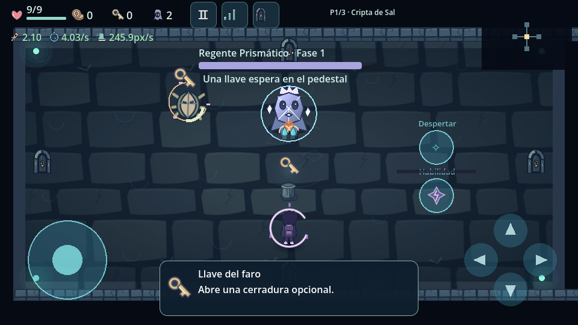
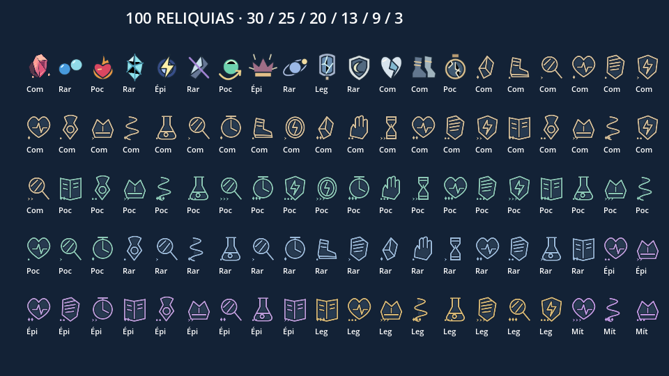

# Determinación y cien reliquias · 0.9.0

Esta entrega amplía 0.8 sin reconstruir el juego: once personajes, nuevas pasivas y reglas activas, progreso mítico verificable y un catálogo de **100 objetos en total**. Las tiendas, cofres, generación por semilla, tres pisos, veinte enemigos normales, recogida, controles, opciones y CI continúan disponibles.

Auditoría previa: [mythic-audit-0.9.md](mythic-audit-0.9.md). Referencia recuperable: `reference/0.8.0-before-mythic-expansion` (`7d664fc`). Rama: `expansion/0.9-shader-and-relics`.

## Shader

Personaje secreto de rareza **Mítica**, independiente de la clasificación de objetos. Su origen se identifica como «Cuando dejé de ser un adolescente». La imagen del autor no estaba disponible: el diseño SVG es **provisional y original, basado en la descripción textual**, sin afirmar fidelidad a una referencia que no se pudo consultar. Conserva cabello negro irregular, ojos oscuros, chaqueta negra, camisa blanca, corbata rojiza, mochila, pantalones oscuros y zapatillas.

Tiene cuatro vistas de combate —frente, espalda, izquierda y derecha—, retrato recortado del recurso ilustrado, movimiento por transformaciones y estados visuales normal, determinado y despertado. Las vistas se cargan cuando se necesitan. No son sprites copiados de otro juego ni un conjunto definitivo de expresiones/animación esquelética.

- **Instinto de Supervivencia:** 6 s, velocidad ×1.25, cadencia ×1.20, daño recibido bruto ×0.70 y evasión inicial breve. Recarga 24 s antes de modificadores de objetos.
- **Despertar del Abismo:** consume 100 de Determinación; dura 8 s, daño permanente ×1.40, cadencia ×1.15, velocidad ×1.10 y una perforación adicional dentro del límite global de cuatro.
- **Voluntad Inquebrantable:** activa +15% de daño permanente y +10% de velocidad al bajar del 35% de vida. Se desactiva por encima del 42%; no parpadea al curar alrededor del umbral.
- **Determinación:** máximo 100, conservada al cambiar de sala. Se obtiene por bajas de jefes/élites/minijefes y encuentros difíciles completados, con bonificación por no recibir daño. Los invocados débiles y las visitas repetidas a salas limpias no permiten llenarla indefinidamente.
- Crítico inicial real: 8%; multiplicador crítico 1.5. El HUD muestra la probabilidad usada por el combate.

La habilidad, el despertar y el objeto activo usan botones y dedos independientes. Los tiempos se congelan al pausar y continúan al cambiar de sala.

Las capturas se obtuvieron del renderizador real de Godot/Mesa. Las vistas reveladas y el combate usan una preparación visual aislada; el juego publicado conserva los requisitos. No son capturas del teléfono ni prueba de fidelidad al dibujo del autor.

## El Camino de la Determinación

Los seis primeros requisitos se acumulan entre partidas y tienen contadores persistentes:

1. Tres jefes principales **con IDs distintos**.
2. Un final principal.
3. Treinta objetos diferentes descubiertos.
4. Diez bajas reales de élites.
5. Cinco secretos descubiertos.
6. Tres salas difíciles completadas sin daño.

Solo después aparece **LA PRUEBA** en la selección del personaje bloqueado. No inicia una partida con Shader: se usa un personaje ya desbloqueado. La prueba consta de tres encuentros consecutivos: combate inicial, grupo con élite y un enfrentamiento final con el Regente Prismático. Las dos transiciones permiten recuperar como máximo un punto de vida cada una. Ganar registra el evento final y desbloquea Shader permanentemente; repetir señales no duplica el premio. La suite automatizada derrota los encuentros y comprueba el desbloqueo, sin introducir un atajo de publicación.

Para que los requisitos sean alcanzables se incorporan:

- **Custodio de la Marea:** abanico, anillo con refugio angular y ataques anunciados.
- **Matriarca de Raíces:** cobertura temporal con salidas abiertas, disparos desde dos posiciones e invocación limitada.
- **Regente Prismático:** cruces de proyectiles, rayos anunciados y disparos bifurcados.
- Los tres tienen dos fases, tres patrones ejecutables, apariencia original y recompensas de jefe.
- Los pisos superiores pueden combinar enemigos normales con élites anunciados. Su ataque adicional usa límites de población/proyectiles y el 15% económico configurado.
- La sala especial de los pisos 2 y 3 contiene un minijefe con patrón adicional y recompensa de una sola entrega. El encuentro permite desbloquear a Orin.

No se reclasifica al antiguo Custodio como tres jefes por cambiarle el nombre: las variantes tienen comportamientos y recursos distintos. El equilibrio manual y la esquivabilidad física en Android aún requieren pruebas de juego.

## Diez personajes revisados

Las rarezas representan complejidad y desbloqueo, no multiplicadores automáticos de estadísticas. `CharacterCatalog` conserva todos los IDs, incluido `neris` para El Errante. Los valores del usuario se adaptan al sistema existente: 1 corazón de diseño equivale a 1.5 unidades de vida, daño dividido por 3.5, velocidad multiplicada por 185/4.8, alcance por 540/5.5 y defensa por 0.15. La cadencia se expresa realmente en disparos/s.

| Personaje | Vida | Daño | Disparos/s | Movimiento px/s | Recarga base |
|---|---:|---:|---:|---:|---:|
| El Errante | 6 | 1.00 | 2.80 | 185.00 | 12 s |
| Nyra | 4.5 | 0.89 | 3.20 | 238.96 | 18 s |
| Kael | 7.5 | 1.49 | 1.80 | 158.02 | 16 s |
| Lumi | 9 | 0.83 | 2.20 | 173.44 | 35 s |
| Vex | 6 | 0.86 | 2.80 | 181.15 | 20 s |
| Orin | 10.5 | 1.03 | 2.00 | 138.75 | 24 s |
| Eira | 6 | 1.00 | 2.20 | 185.00 | 22 s |
| Solen | 6 | 1.20 | 2.60 | 192.71 | 19 s |
| Mira | 4.5 | 0.86 | 3.00 | 200.42 | 28 s |
| Nox | 4.5 | 1.57 | 3.30 | 219.69 | 30 s |
| Shader | 9 | 1.50 | 3.50 | 223.54 | 24 s |

- Errante: primer especial completado por piso concede velocidad breve, sin renovación al revisitar.
- Nyra: desplazamiento y señuelo de 4 s; un impacto realmente evadido durante la ventana correspondiente concede velocidad temporal una sola vez.
- Kael: preparación de 0.35 s y recuperación; cada cuarto impacto principal genera dos fragmentos que no se fragmentan a sí mismos.
- Lumi: campo con máximo 1.5 de recuperación por activación y **4.5 de curación total por partida**; el presupuesto se conserva al viajar. Su pasiva reduce brevemente el siguiente impacto.
- Vex: alterna fuego, hielo, electricidad y veneno; combinar dos elementos produce una reacción adicional con enfriamiento y daño limitado.
- Orin: reducción de contacto y barrera con presupuesto de 2.5 de daño; puede agotarse antes de terminar su duración.
- Eira: acumulación de frío limitada y congelación breve de normales. Los jefes resisten la inmovilización.
- Solen: quemadura probabilística moderada; menor eficacia sobre núcleos resistentes. Onda de fuego activa.
- Mira: copia de 7 s con 45% de daño individual; un proyectil que pasa realmente cerca mientras se mueve permite una ilusión de distracción, con recarga y límite de una. Los nuevos guardados requieren secreto y Prueba de Ilusiones; los desbloqueos anteriores se conservan.
- Nox: mejora ofensiva y movilidad, seguida de fatiga; las bajas conceden hasta tres acumulaciones temporales, sin contaminar estadísticas permanentes.

La selección muestra rareza, estadísticas reales, barras, retrato, activa, pasiva, ventajas y desventajas. La bitácora izquierda admite desplazamiento táctil para no recortar textos. Hay efectos visuales propios dibujados con un número pequeño de trazos, sin luces dinámicas ni nodos por partícula. Se conservan los dibujos anteriores; **el rediseño artístico final completo de los diez personajes y sus expresiones sigue pendiente**.

## Cien objetos funcionales

Se cuentan las catorce reliquias anteriores, sin duplicarlas: **30 comunes, 25 poco comunes, 20 raras, 13 épicas, 9 legendarias y 3 míticas**. Lista completa, descripciones y límites: [catálogo real](relic-catalog-0.9.md).

Las 86 entradas nuevas usan recetas validadas en `data/relics_expansion.json`. `RelicEffects` separa constantes, disparos, impactos, recogida, actualización, bajas, salas, daño recibido, habilidades, activos y desafíos. Las recetas tienen condiciones, probabilidades, contadores, presupuestos y recargas; se rechazan operaciones desconocidas, valores no finitos, contadores fraccionarios, duraciones ausentes y metadatos inválidos.

Hay modificaciones de estadísticas y mecánicas reales: guía, retorno, fragmentación, empuje, atracción, marcas, críticos, veneno, congelación, explosiones, escudos, curación limitada, recargas condicionadas, copia ofensiva, ralentización de proyectiles hostiles y recompensa presupuestada. Los secundarios no reentran en el sistema de generación, para evitar recursión. Límite: doce proyectiles por ataque principal, cuatro perforaciones, dos rebotes, 96 proyectiles globales, dieciséis enemigos y límites existentes de efectos/peligros.

El radio de recogida ampliado **no compra productos gratis**. Comprar sigue reservando/descontando/entregando una sola vez. La selección de emergencia de la tienda ahora respeta los pesos cero de rareza, en vez de introducir productos que la tabla excluía.

Los objetos activos se equipan desde el inventario de pausa y tienen botón propio. Cada objeto conserva su recarga al equipar otro y volver; los consumibles tienen presupuestos de partida. El laboratorio muestra catorce objetos por página, ocho páginas que cubren los cien; cambiar de página conserva las combinaciones de prueba. El laboratorio no concede descubrimientos permanentes.

Esta galería es de revisión interna, no una pantalla que instancie cien objetos completos en el teléfono. El atlas original compartido evita ochenta y seis texturas/nodos independientes.

### Míticos y probabilidades

- Corazón de la Determinación: poder temporal tras un desafío real y Determinación adicional para Shader; beneficia a los demás mediante el poder temporal.
- Fragmento del Origen: patrón compuesto de tres proyectiles, perforación y alternancia elemental, dentro del presupuesto compartido.
- Corona del Último Horizonte: poder/protección y copia breve al activar una habilidad; el mismo modificador no se acumula consigo mismo.

`data/balance.json` pasa a esquema 2 con seis columnas por fila. La tabla base coincide con la solicitada: Mítico 0% en pisos 1–5 y 0.2% desde el sexto. El juego actual sigue teniendo tres pisos: las filas 4–6 son configuración preparada, no pisos que se hayan inventado como existentes.

Para que exista una oportunidad excepcional dentro del contenido actual, solo fuentes propias del tercer piso incluyen pequeñas probabilidades Míticas: secreto 0.05% y jefe 0.02%, después de completar un final principal. Los demás contextos mantienen tablas independientes. Cuando el nivel Mítico está bloqueado, su pequeña masa se dirige al nivel legendario. No hay un Mítico garantizado en cada partida. Las filas suman 100 y pueden editarse mediante los datos, sin reescribir el combate.

## Guardado y protección contra regresiones

`user://progress.json` usa formato 2 con migración desde el formato 1, tipos de jefes distintos, élites y desafíos. Los códigos AOT1 se aceptan y los nuevos se exportan como AOT2. La importación combina máximos/descubrimientos y nunca elimina personajes desbloqueados. No existe todavía continuación de una partida en curso.

Se mantienen escritura temporal, respaldo `.bak`, recuperación y deduplicación. Los jefes viejos sin identidad diferenciada no se convierten artificialmente en tres tipos. Se corrige también la referencia compartida de datos que permitía al objetivo del laboratorio cambiar el daño de enemigos de partidas posteriores. Las maldiciones temporales usan una fuente separada para no dejar cambios permanentes al expirar otros poderes.

## Pruebas y límites de la entrega

- La referencia 0.8 superó sus trece suites antes de modificarla.
- Importación, escenas, recursos y **quince suites** de regresión e integración se ejecutan mediante `tools/validate.py`.
- Suite de expansión: **716 comprobaciones**, con cien recogidas reales, iconos, distribución, 99 ramas de recetas, presupuestos, tienda/magnetismo, minijefe, tres jefes, acceso a la prueba, victoria/desbloqueo real, recurso de Shader, cinco dedos simulados y combinaciones máximas.
- Suite de pasivas: **22 comprobaciones** de efectos efectivos, agotamiento y límites, no solo presencia de descripciones.
- La suite de expansión también se ejecutó con Compatibility/Mesa y pasó. No equivale a un dispositivo Android.
- Capturas reales y [muestra de diagnóstico](mythic-diagnostics-0.9.json): alrededor de 39 MB de memoria estática del asignador del motor y 28 MB de texturas en una escena preparada de dos enemigos. **No son RSS del proceso, memoria Android, prueba de carga máxima ni medición comparativa de FPS.** El renderizador era llvmpipe de un servidor Linux.
- Exportación local ARM64 firmada: 29,760,292 bytes (29.76 MB). El tamaño exacto de CI se registra en el PR y `apk-size.json` después de compilar.
- La exportación verifica ZIP, firmas, paquete/versión/ABI, compatibilidad Android 13, ausencia de Internet y presencia/contenido exacto de **ambos JSON de ejecución**.

No se han añadido archivos para inflar el tamaño. El mínimo de 100 MB pedido en la entrega anterior **continúa pendiente**; faltan recursos gráficos y sonoros de producción que justifiquen ese espacio. La opción de exigir 100 MB en Actions sigue fallando si se activa para una compilación más pequeña. Esta entrega no se presenta como arte definitivo ni prueba de rendimiento en ZTE.

Firma: el workflow existente usa una clave de depuración efímera. La integración devolvió HTTP 403 al gestionar secretos en 0.8 y no se dispone aquí de una firma estable configurada. Antes de cualquier reinstalación, copiar **Opciones → Progreso → Copiar código** a las notas del teléfono; la nueva versión acepta el AOT1 de 0.8. No se ha publicado una clave de producción.

### Pendiente en el ZTE 8050

1. Abrir el APK de Actions y comprobar la selección, desplazamiento de la bitácora y bloqueo de los once viajeros.
2. Verificar movimiento/disparo/habilidad/objeto/despertar con dedos distintos y en perfiles Bajo/Medio/Alto.
3. Completar los nuevos encuentros sin trampas de prueba, valorar señales, daño y dificultad.
4. Descubrir objetos, comprar/recoger, equipar activos y comprobar sus recargas al cambiar de sala.
5. Cerrar/abrir la aplicación y restaurar un código AOT1/AOT2 para verificar conservación del progreso.
6. Medir FPS, memoria y calentamiento con condiciones comparables; no se promete 60 FPS sin esa medición.
7. Revisar fidelidad del dibujo de Shader cuando el autor adjunte su referencia y completar el arte/animación definitivo.
