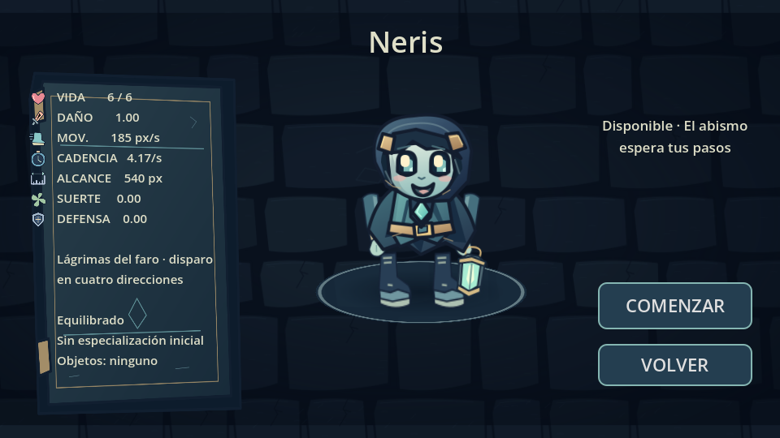
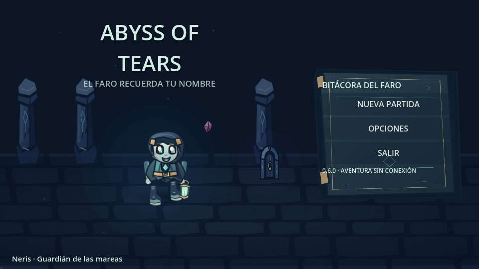
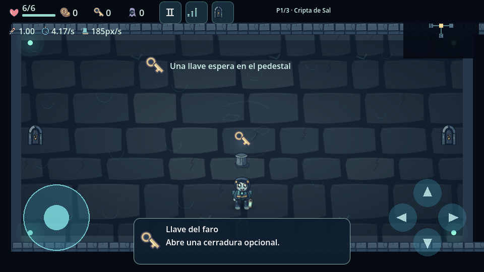
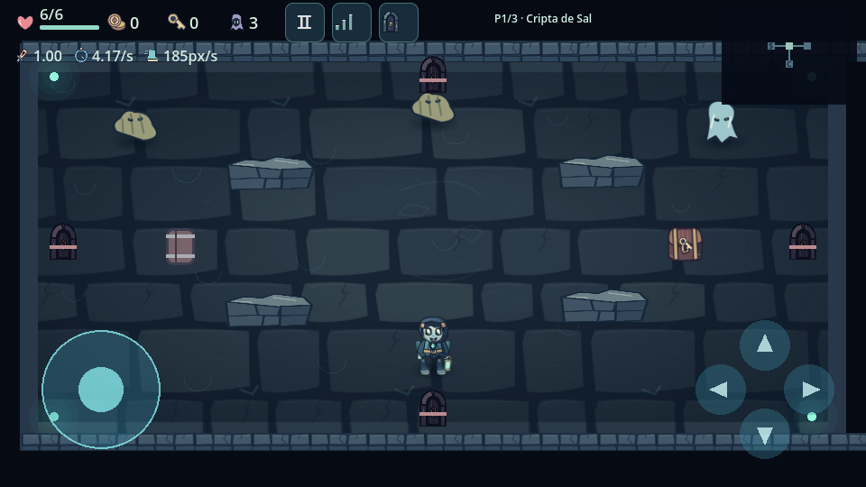

# Referencias visuales y Entrega B · 0.6.0

Se usan las imágenes del usuario como referencia de jerarquía y comodidad:
centro de combate claro, indicadores discretos, protagonista en el centro de la
selección y atributos a la izquierda. No se incorporan las capturas al juego ni
se copian tipografía, papel clavado, personajes, fondos, habitaciones o sprites.
El cuaderno de navegación azul, las ilustraciones y la presentación son originales.

## Presentación

Nueva partida muestra la ficha de Neris en un panel izquierdo de aproximadamente
30 %, el personaje animado en el centro y estado/COMENZAR/VOLVER a la derecha.
Vida, daño, velocidad, cadencia, alcance, suerte y defensa se leen del catálogo
que inicializa la partida. No se inventan habilidades activas o personajes.
Neris es equilibrado, sin especialización inicial ni reliquias iniciales.
Los personajes bloqueados y sus requisitos conservan su validación; no hay
flechas en el catálogo real de un solo personaje.

El menú conserva Nueva partida, Opciones y Salir, con el protagonista animado.
Su panel utiliza una bitácora ilustrada azul y herrajes propios; no reproduce
los papeles, la caligrafía o la disposición exacta de las referencias.
Continuar permanece oculto porque no existe guardado completo de partida.

## Doce distribuciones interiores

`RoomBlueprint` genera una descripción de coberturas mediante semilla, piso e
identificador de habitación. El exterior rectangular y los cuatro puntos de
puerta permanecen compatibles con la navegación. No se presentan estas doce
plantillas interiores como doce formas externas distintas ni como 36 categorías.

1. Atrio despejado.
2. Islas de piedra.
3. Cobertura lateral.
4. Muros quebrados.
5. Cuatro rincones.
6. Cruce abierto.
7. Pasillos de escombros.
8. Pantallas asimétricas.
9. Núcleo cerrado (obstáculo central sólido, sin encerrar una recompensa).
10. Galería horizontal.
11. Vigías de piedra (estatuas que sirven de cobertura).
12. Arena amplia.

Los desplazamientos pequeños y deterministas varían sus posiciones. Una misma
semilla conserva exactamente la geometría al volver. No se colocan siempre las
cuatro columnas antiguas. Inicio, tienda, tesoro, cámara secreta, sala especial
y jefe usan espacio abierto para permitir recoger, comprar y esquivar ataques.
Los modos de prototipo y laboratorio conservan su disposición anterior.

Rocas y estatuas tienen cuerpos circulares reales; los muros quebrados, cuerpos
rectangulares. La detección de proyectiles usa la misma geometría y los objetos
se colocan fuera de ella. Los barriles destructibles, trampas, palancas, cofres y
recompensas existentes se conservan. Los trazos de raíces/escombros decorativos
no tienen colisión. Los muros nuevos son cobertura sólida, no se anuncian como
obstáculos destructibles.

## Accesibilidad y carga

Antes de usar cada plantilla se comprueba una cuadrícula de 21×9, con margen de
16 px, superior al radio de 13 px del jugador. Una búsqueda en anchura verifica
que el inicio, las cuatro puertas y todos los centros libres pertenezcan a la
misma región; también se comprueban los segmentos entre centros. Si una
combinación no pasa, se utiliza el atrio despejado como respaldo seguro.

Se valida y se cargan cuerpos únicamente para la habitación actual. El límite
es de cuatro coberturas interiores más los cuatro muros exteriores, sin cargar
simultáneamente las escenas completas de las otras habitaciones. La elección
se hace al entrar, no por fotograma. Los perfiles gráficos cambian decoración,
no la forma o las colisiones. Las semillas, tres pisos, minimapa y progresión
hasta el Custodio se conservan.

La aparición de enemigos se reubica usando la geometría actual; la colocación de
objetos conserva además sus comprobaciones de otros premios, props y puertas.
Los enemigos mantienen sus IA anteriores: esta entrega no añade navegación de
caminos nueva para cada enemigo ni cambia sus ataques.

## Pruebas ejecutadas

La base 0.5.1 pasó antes de modificarla. La versión nueva pasa importación,
rutas, arranque y once suites. `room_structure_tests.gd` hace 10.475 comprobaciones:

- 1.152 combinaciones: 32 semillas × 3 pisos × 12 índices, repetidas para
  comprobar determinismo. Aparecen las doce plantillas y más de cien geometrías.
- Acceso a todas las anclas y a todos los centros libres, sin respaldos en esa
  muestra. Se corrigió una pantalla asimétrica que invadía el inicio en algunas
  combinaciones; no se desactivó la comprobación para aceptarla.
- Posiciones resueltas de enemigos y premios fuera de estructuras.
- Física real: un rayo de colisión detecta el muro y el barrido de un proyectil
  existente lo golpea.
- Reentrada, tres perfiles, selección izquierda y comienzo de partida.

La prueba de pisos ahora usa una semilla explícita y una primera puerta del
grafo original: la ruta aleatoria anterior podía derrotar al jefe y más tarde
suponerlo sin derrotar. Se conserva la comprobación de bloqueo por jefe y la
suite de exploración sigue completando los tres pisos mediante daño real.
La prueba de perfiles compara la geometría seleccionada antes y después, en
lugar de exigir las columnas antiguas en todas las habitaciones nuevas.

La suite de estructuras también pasó con Compatibility/OpenGL Mesa. Se revisaron
capturas reales del motor del menú, selección, inicio y combate. No son capturas
del ZTE. Las pruebas anteriores siguen verificando HUD, multitáctil, compra,
recogida, cofres, guardado de opciones, enemigos y progresión.

## Probar desde Android

Descargar el APK ARM64 0.6.0 de GitHub Actions, extraer el ZIP e instalarlo.
Abrir Nueva partida → Neris → COMENZAR. Comprobar la sala inicial despejada y
visitar varias habitaciones. Para reproducir la captura: Opciones → Modos y
pruebas → Elegir semilla → 4, después explorar esa mazmorra.

Pendiente: instalación, tacto y rendimiento físico en ZTE 8050. No se afirma
haber medido 60 FPS. El guardado de opciones se mantiene; todavía no hay guardado
completo de partidas. Economía, rarezas, más personajes, formas externas L/T/cruz
y las 36 categorías siguen pendientes de sus entregas correspondientes.
