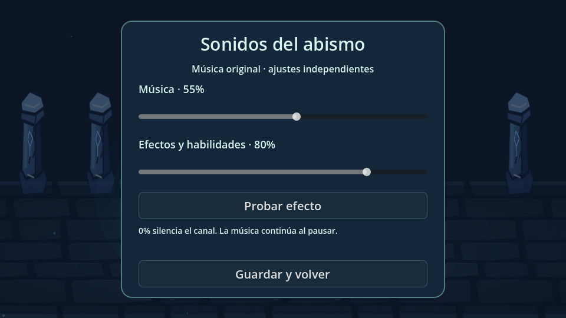

# Los doce viajeros — auditoría y primera entrega (0.10.0)

Referencia protegida: `5bb964af48d407a08ebd6c22416ca6ee2974e933` (versión pública 0.9.1), etiqueta `reference/0.9.1-before-travelers`. Rama `expansion/0.10-original-soundtrack`. No se reconstruye el proyecto ni se sustituyen pisos existentes.

## Auditoría del código y pruebas

| Sistema | Estado comprobado | Ubicación principal |
| --- | --- | --- |
| Godot / Android | Godot 4.6.3; Compatibility; 960×540 horizontal; ARM64, sin permiso INTERNET | project.godot, export_presets.cfg |
| Inicio y menús | Escena principal real; selección, opciones, práctica táctil, pausa, victoria/derrota | scenes/main.tscn, scripts/core/game.gd, scripts/ui |
| Personajes | 11 entradas, selección de bloqueados, estadísticas reales, activas y pasivas verificadas por las suites existentes | scripts/characters, scripts/player/player.gd |
| Shader | Personaje Mítico secreto con Determinación, despertar y prueba permanente; arte provisional de la descripción | character_catalog.gd, rules.gd, progress.gd |
| Enemigos | 20 comportamientos normales; rango élite y minijefe; no cinco élites o tres minijefes con identidades completas | scripts/enemies |
| Campaña | Tres pisos: Cripta de Sal, Jardines Hundidos y Falla de Cristal | scripts/generation/floor_layout.gd |
| Jefes | Custodio de la Marea, Matriarca de Raíces y Regente Prismático; patrones y dos fases existentes | scripts/bosses/tide_warden.gd |
| Procedural | Semillas, 12 habitaciones por piso con exploración, ruta al jefe, tienda, tesoro, secreto; 12 distribuciones interiores | floor_layout.gd, room_blueprint.gd, room_content.gd |
| Objetos | 100 objetos; estadísticas y efectos limitados; rarezas, activos y combinaciones | scripts/items, data/relics_expansion.json |
| Compra / cofres / recogida | Transacción común con reserva, validación, devolución y estados contra duplicación; recompensas físicas | game.gd, pickup.gd, pickup_interaction_tests.gd |
| Economía | Probabilidades y precios por piso configurables; fuentes de moneda limitadas | scripts/economy/economy.gd, data/balance.json |
| Controles | Multitáctil, disparo independiente, mano izquierda, zona muerta, joystick flotante y práctica | touch_controls.gd, control_accessibility_tests.gd |
| Guardado | Progreso permanente v2 con migración desde v1, respaldo e importación; configuración v1 | scripts/saving |
| Continuar partida en curso | **No implementado**. No se promete guardar ni migrar una expedición activa | main_menu.gd, progress.gd |
| Audio anterior | Solamente motivos breves de habilidades y desbloqueos | character_sounds.gd |
| Arte / rendimiento físico | Arte mixto provisional y animación por transformaciones; calidad final y FPS en ZTE **no verificables aquí** | assets, pruebas físicas pendientes |
| Nuevos viajeros / campaña ampliada | Los doce nuevos personajes, nueve pisos adicionales y doce jefes propuestos **no implementados en esta entrega** | siguientes etapas |

La validación de referencia pasó completa: 16 suites Godot y nueve pruebas Python. Los nombres y orden de los tres pisos actuales difieren de la propuesta nueva. Se conservan sin reinterpretarlos ni cambiar los requisitos de los desbloqueos existentes. El mensaje de expansión recibido se interrumpe en «PISO 9 — TORRE DE LAS TORMENTAS»; faltan la continuación y los pisos 10–12.

## Primera entrega funcional: banda sonora y director de audio

- 13 composiciones originales sintetizadas, en Ogg Vorbis estéreo de 44,1 kHz. Instrumentación de campanas, colchones armónicos, bajo y percusión propia; ningún sample o melodía de otro videojuego.
- Música de menú; exploración, combate y jefe para cada uno de los **tres pisos actuales**; tema de eventos tranquilos, victoria y derrota.
- Son composiciones breves de ocho compases con variaciones e instrumentación compartida, una primera dirección musical. **No equivalen todavía a una banda sonora terminada para doce pisos.**
- Once efectos originales mono 22,05 kHz: disparo, impacto, daño, derrota de enemigo, moneda, reliquia, compra, apertura de cofre, puerta, error y pulsación.
- Director persistente: hasta dos pistas durante el fundido de 0,7 s, liberación del recurso anterior, carga de una pista al cambiar de contexto. No se carga todo el catálogo de música.
- Seis voces máximas de efectos nuevos y limitación por tipo; se conserva el reproductor anterior para habilidades/desbloqueos. Máximo: dos voces musicales, seis efectos y una voz de personaje.
- Pausar conserva la posición de la música y baja su volumen. Perder foco pausa los streams y detiene efectos; volver no reanuda el combate automáticamente.
- Opciones → Música y efectos: volúmenes independientes y persistentes; 0% silencia un canal. Los sonidos anteriores de personajes también obedecen el canal de efectos.
- Los sonidos de compra, recogida y cofre se conectan a transiciones aceptadas. Un intento rechazado o repetido no reproduce otra recompensa.
- Salida normal y pruebas esperan a que el mezclador libere buffers detenidos; no se desactivan las comprobaciones de errores ni de fugas para ocultar problemas.
- Exportación y publicación verifican `soundtrack.json`, los 24 remapeos y los recursos de audio importados dentro del APK.

## Catálogo musical

| ID | Pieza | Tempo | Duración |
| --- | --- | --- | --- |
| menu | Una luz conserva tu nombre | 76 BPM | 25.26 s |
| salt_explore | Campanas bajo la sal | 80 BPM | 24.00 s |
| salt_combat | El pulso de la cripta | 104 BPM | 18.46 s |
| salt_boss | Juramento de la marea | 116 BPM | 16.55 s |
| garden_explore | Raíces que recuerdan | 84 BPM | 22.86 s |
| garden_combat | Esporas en la penumbra | 108 BPM | 17.78 s |
| garden_boss | La promesa enterrada | 120 BPM | 16.00 s |
| crystal_explore | La falla canta | 88 BPM | 21.82 s |
| crystal_combat | Fragmentos en marcha | 112 BPM | 17.14 s |
| crystal_boss | Corona de resonancias | 124 BPM | 15.48 s |
| special | Un trato con la luz | 80 BPM | 24.00 s |
| victory | El faro abre los ojos | 92 BPM | 20.87 s |
| defeat | Todavía queda una brasa | 68 BPM | 28.24 s |

El archivo `data/soundtrack.json` registra títulos, tempo, compases, motivo, duración y SHA-256. `tools/compose_soundtrack.py` contiene las notas, síntesis y arreglos originales. Regenerarlo es una tarea opcional de desarrollo con numpy y ffmpeg; ni el teléfono ni los workflows necesitan esas herramientas, porque los Ogg/WAV están guardados en Git.

## Pruebas de esta entrega

`tools/validate.py` conserva las suites existentes y añade interacción de audio y salida real del mezclador. Las comprobaciones abarcan carga de las piezas, duraciones, SHA, rutas, repetición, presupuesto de voces, interrupción de fundidos, pausa, foco, silencio independiente, guardado, tamaño táctil y compra/recogida sin sonidos duplicados. El publicador rechaza registros o remapeos ausentes, vacíos o alterados.

Las mediciones de `audio-measurements-0.10.json` proceden de decodificar los trece Ogg con ffmpeg: señal no silenciosa, estéreo diferenciado, pico por debajo de saturación y diferencia entre las muestras de unión. Esto es una comprobación de señal; **no prueba calidad perceptiva ni rendimiento en Android**. La prueba de mezclador captura la salida de AudioServer en el runner, no los altavoces del ZTE.

Pruebas físicas pendientes: escuchar los bucles y fundidos con auriculares/altavoz, probar silenciar cada canal, bloquear/desbloquear la pantalla durante combate y menú, confirmar compra/cofre/recogida, guardar/cargar los volúmenes, jugar un piso y medir FPS/memoria con y sin música en condiciones comparables. No se promete una mejora medida de rendimiento.

## Siguientes entregas de la expansión

1. Aren: carga limitada, modos rápido/concentrado, ralentización al concentrar, Resonancia sin recursión y desbloqueo por tres tipos de sala especial distintos. Añadir los eventos persistentes necesarios sin simular logros pasados.
2. Integrar los viajeros restantes en grupos verificables, conservando los once IDs anteriores y sus desbloqueos. Ninguna entrada nueva se presentará como jugable si su habilidad no funciona.
3. Separar datos de campaña de los límites actuales de tres pisos, incorporar nuevos pisos/jefes uno a uno y validar navegación, recompensas, economía y transiciones con múltiples semillas. Resolver el orden propuesto respecto al contenido actual.
4. Completar la especificación recibida para pisos 9–12. Ampliar audio, arte, enemigos y mecánicas al integrar cada piso.
5. Validar la campaña de doce pisos y 23 personajes con sus jefes, desbloqueos, balance y pruebas en teléfono. El requisito anterior de APK ≥100 MB permanece pendiente y no se rellenan archivos para alcanzarlo.

El guardado actual no cambia de versión: se añaden dos campos opcionales de configuración con valores por defecto y validación. No se borran desbloqueos ni objetos descubiertos. La firma de depuración de CI sigue siendo efímera; conservar el código de progreso antes de reinstalar.

## Registro de verificación

- Interacción de audio: 219 comprobaciones sin fallos, tanto headless como Compatibility/Mesa en escritorio.
- Mezclador AudioServer: 24 capturas (13 pistas y 11 efectos) sin silencio inesperado ni saturación.
- Salida normal con drenaje: ejecutada sin errores ni avisos de recursos pendientes.
- Exportación local: APK ARM64 0.10.0, código 16; 31.838.661 bytes. Referencia pública 0.9.1: 29.772.753 bytes; aumento útil de 2.065.908 bytes (+6,94%). El APK de CI puede diferir unos bytes por su firma.
- Mínimo de 100 MB: pendiente. FPS y memoria de Android con música: pendientes de medición en el teléfono.

La captura del mezclador espera muestras reales con un límite de 2,5 s, en vez de suponer que el hilo de audio entrega un bloque dentro de un retardo fijo. Esta corrección elimina una condición de sincronización detectada al ejecutar exportación y pruebas a la vez.
