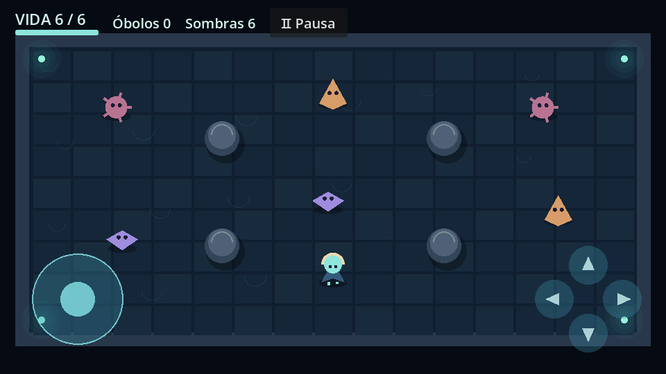

# Resultados verificados — fase 1

Fecha UTC: 2026-10-26 16:56.

## Ejecutado en el entorno de Codex

| Comprobación | Resultado |
| --- | --- |
| Descarga del editor y plantillas oficiales; SHA-256 | Correcto, Godot 4.6.3 estable |
| Importación, scripts, referencias y escena principal | Correcto |
| Arranque de escena principal en headless | Correcto |
| Pruebas de comportamiento en headless | **38 comprobaciones, 0 fallos** |
| Mismas pruebas con OpenGL Compatibility / Mesa llvmpipe | **38 comprobaciones, 0 fallos** |
| Capturas de menú, habitación y opciones | Generadas y revisadas |
| Sintaxis de workflows, actionlint 1.7.12 | Correcto |
| Exportación con Temurin 17.0.21+9 y build-tools 36.0.0 | Correcto |
| ZIP del APK, manifiesto, bibliotecas y tamaño | Correcto |
| Firma comprobada con apksigner | **v2 y v3 válidas** |
| Paquete / ABI | `org.abyssoftears.game` / `arm64-v8a` |
| Android mínimo / objetivo | API **24** / API **36** |
| Permiso de Internet | Ausente |
| Licencias del motor dentro del APK | Presentes |
| Archivos de tests/herramientas dentro del APK | Excluidos |

APK: `build/AbyssOfTears-debug.apk`, **27,728,688 bytes**.

SHA-256:

```text
420672b6b1ee99f96663e8d8781d34776470551c01ab5dbd700085f61f312a61
```

Las pruebas cubren recuperación de JSON dañado, guardado y recarga, límites de
estadísticas, menús y créditos, movimiento y ataque con dedos simultáneos,
normalización diagonal, orden de liberación de dedos, pausa, cadencia,
invulnerabilidad, barra de vida, colisiones de paredes y proyectiles, alcance,
recompensas, victoria, derrota, reinicio, pérdida de foco, límite de proyectiles,
pantallas anchas y controles al tamaño máximo. También se ejercitaron los tres
perfiles gráficos. Las capturas proceden de Godot renderizando el proyecto;
no son una simulación dibujada aparte.

El servidor gráfico virtual avisa que no permite cambiar V-Sync. Esto no impide
las pruebas y no mide el rendimiento del teléfono. Se utilizó software Mesa
para renderizar; no se afirma equivalencia con la GPU del ZTE.

## Alcance del registro local

Este informe registra las pruebas locales previas a la publicación. El proyecto
se entrega en https://github.com/sresquizofrenico/AbyssOfTears mediante la rama
`delivery/android-apk`. El estado de las compilaciones y sus artefactos se
consulta en https://github.com/sresquizofrenico/AbyssOfTears/actions.

Siguen pendientes de comprobación física la instalación en el ZTE 8050, la
pantalla táctil y el rendimiento, memoria, consumo y temperatura en Android 13.
Un APK exportado localmente no demuestra que una ejecución de GitHub haya
terminado correctamente: debe comprobarse el resultado de esa ejecución.

## Reproducir en el entorno de desarrollo

`python3 tools/validate.py` ejecuta las comprobaciones headless. La exportación
se hace con `python3 tools/export_android.py` y las variables documentadas en
`android-build.md`. Estos comandos son para Codex y el runner, no para el teléfono.


